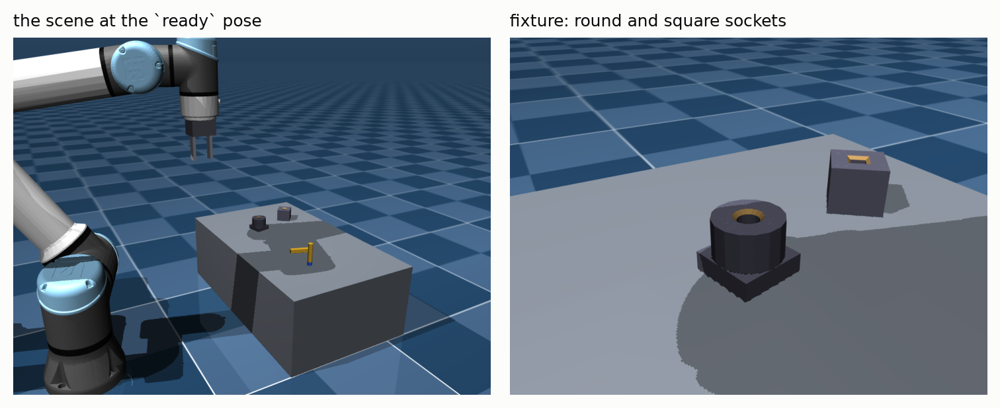
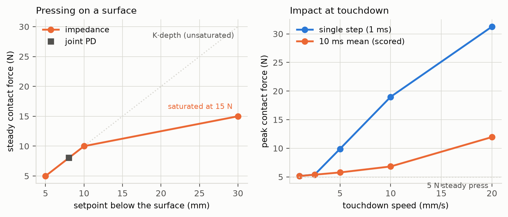
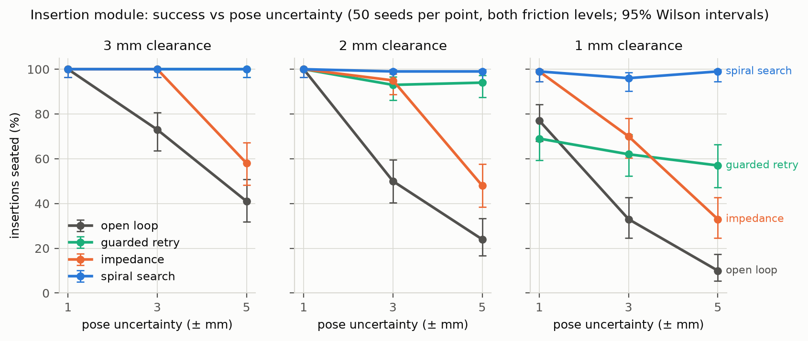
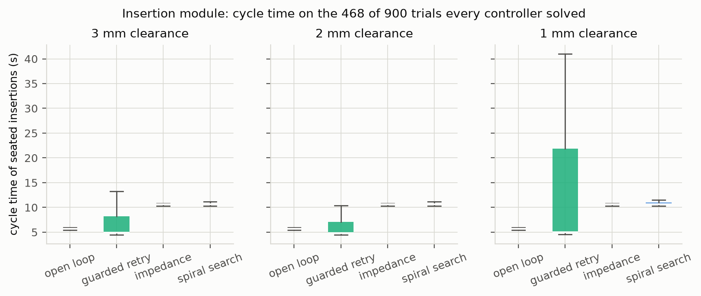
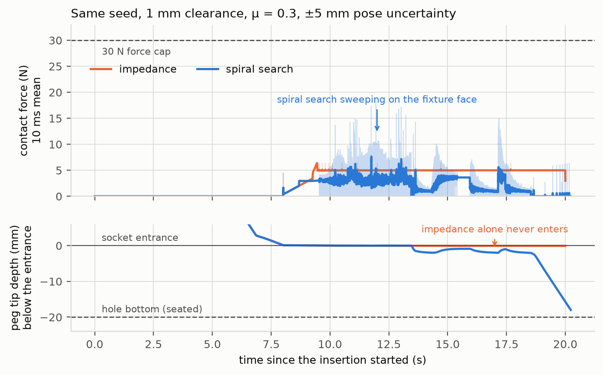
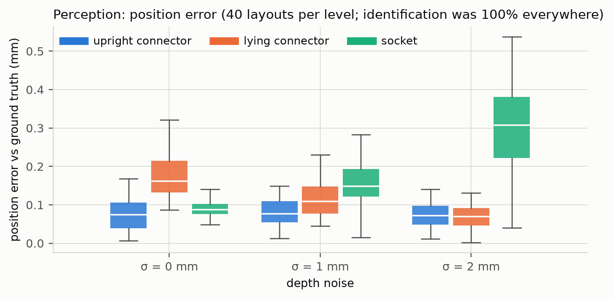
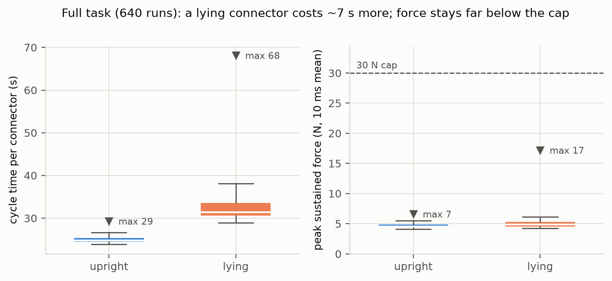
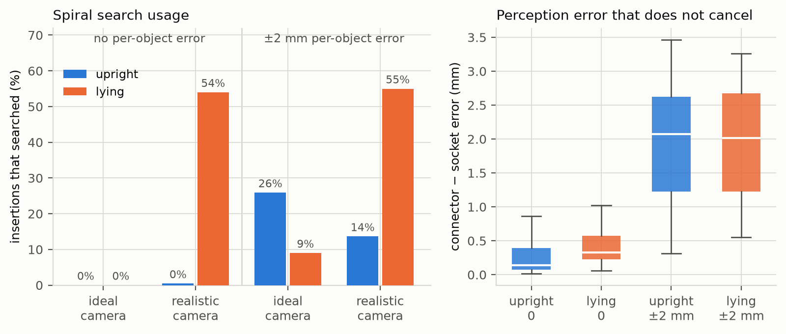
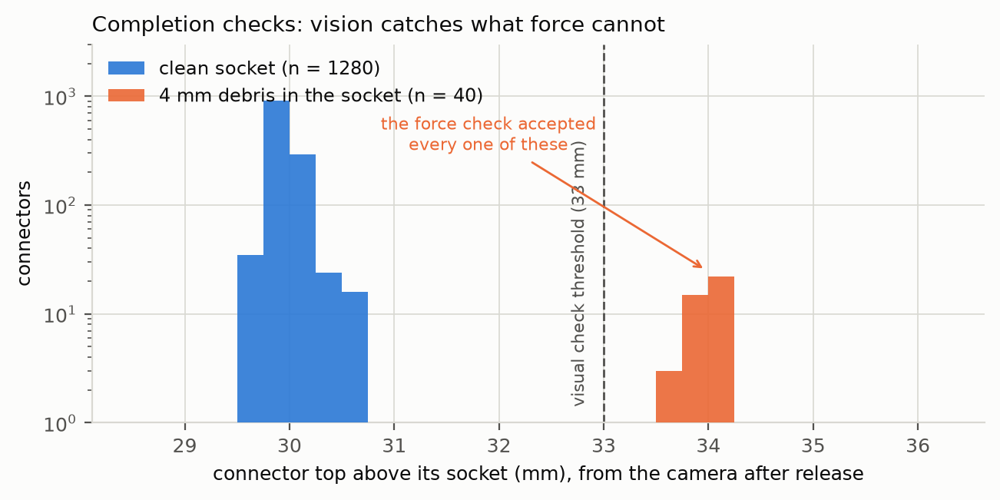

# Vision-Guided Contact-Rich Connector Insertion with Compliant Control

**CS5478 Intelligent Robots — Project Report** · *Draft (weeks 1-6). `TODO` marks sections filled in later weeks.*

---

## Abstract

At millimetre clearances the pose error between a gripper and a socket exceeds the clearance itself, so a
position-controlled arm jams instead of seating the part. We study this in MuJoCo in two stages. First, an
*insertion module*: a torque-level Cartesian impedance controller with contact-triggered spiral search inserts a peg
under a believed socket pose that is wrong by up to ±5 mm. Over 3,600 trials it seats 99.1 % against 86.1 % for a
guarded-move-with-retry baseline, 78.1 % for impedance alone and 56.4 % open loop (paired, exact McNemar
p ≈ 1.5 × 10⁻¹¹). Second, the *full task*: an overhead RGB-D camera locates two keyed connectors, standing or lying on
their side, and the robot identifies each, plans an antipodal grasp, turns a lying connector upright in the hand, and
inserts it into its own socket. Over 1,120 runs every connector was seated in the correct socket; spiral search was
needed in up to 55 % of insertions once perception error no longer cancelled between part and socket.

---

## 1. Introduction

Inserting wire terminals and connectors into sockets remains one of the least automated steps in electronics assembly. At millimetre scale the uncertainty between gripper and socket pose exceeds the insertion clearance, so a purely position-controlled arm jams or damages the part instead of seating it. The task is *contact-rich*: success depends on how the robot responds to contact, not only on where it moves.

This project studies a scoped version of the problem in simulation: a 6-DOF arm inserts a rigid connector into a socket with 1-3 mm clearance under bounded pose uncertainty. We compare an open-loop insert, a guarded-move-with-random-retry baseline, and a compliant controller (Cartesian impedance with contact-triggered spiral search) over a grid of clearances and uncertainty levels.

> TODO: one sentence on the Intrinsic × Open Robotics AI for Industry Challenge as motivation, with a citation (verify figures against a primary source first).

The project then extends that module into a full perception-driven task: an overhead RGB-D camera, two keyed
connectors that may be standing or lying on their side, and two sockets, with every pose the controller uses coming
from the camera.

**Contributions.** (1) A reproducible MuJoCo environment for keyed-connector assembly with contact behaviour validated
at 1 mm clearance; (2) an evaluation harness that separates what a controller may observe from ground truth, and scores
seeded trials across clearance, friction, perception noise and part orientation; (3) a controlled comparison of
non-compliant and compliant insertion strategies (99.1 % vs 56-86 % over 3,600 trials); (4) a classical perception and
grasping pipeline that identifies, localises and orients both connectors — including turning a lying connector upright
in the hand without re-grasping — and seats both in 1,120 of 1,120 runs; (5) a measurement of *which* perception errors
actually stress contact-rich insertion, and of what a second, independent completion check is worth.

---

## 2. Task and Setup

### 2.1 Task

**Insertion module (weeks 1-5).** A UR5e with a round peg rigidly attached to its flange must insert the peg into a
square socket. The cable behind the connector is treated as rigid (§7).

- **Clearance** *c* (total): hole width = peg diameter + *c*, with *c* ∈ {3, 1} mm (baseline grid).
- **Pose uncertainty**: the controller receives a *believed* socket entrance offset from the true one by a seeded uniform xy error in ±*u*, *u* ∈ {2, 5} mm. It never observes the true pose.
- **Start pose**: home configuration plus seeded uniform joint noise (±0.25 rad), resampled until collision-free.
- **Friction**: μ = 0.3 (typical of brass or tin-plated pins in plastic housings) is the main setting; μ = 0.8 (dry steel on steel) is a high-friction benchmark.
- **Success**: the peg tip reaches within 2 mm of the hole bottom, inside the hole footprint, within the cycle-time budget (60 s), without the contact force exceeding the 30 N cap. The cap applies to the 10 ms moving average of the true contact force (sustained force). Single-step (1 ms) peaks are reported separately: they scale with contact speed and the solver's contact stiffness, and safety standards such as ISO/TS 15066 treat transient contact separately from quasi-static force.

**Full task (weeks 6-7).** The peg is replaced by a parallel-jaw gripper, and pose uncertainty comes from perception
instead of a synthetic offset. Each trial places **two keyed connectors** — one round (Ø10 mm), one square (8.5 mm),
both 50 mm long, with a coloured band marking the insertion end — at random non-overlapping poses in a pick area, each
either standing upright or lying on its side. A fixture holds a round and a square socket at random positions and
yaws. Using only the camera, the robot must find the **round connector first**, grasp it, insert it into the round
socket and release it, then do the same for the square one. Each connector physically fits only its own socket at
1 mm clearance (the round peg is wider than the square hole; the square peg's diagonal is wider than the round hole's
widest point), mirroring connector keying, and the harness scores "correct socket" explicitly because that exclusivity
weakens at larger clearances.

- **No ground truth reaches the controller.** Connector and socket poses, part identity, orientation and which end is
  the insertion end all come from the camera. Ground truth is used only for scoring.
- **Success**: both connectors seated in their own sockets, marked end first, still seated after release, within the
  force cap.

### 2.2 Simulation environment

- **Simulator**: MuJoCo 3.x at 1 ms timestep, implicit-fast integrator, elliptic friction cones. Chosen over PyBullet for more stable, accurate contact at millimetre scale.
- **Robot**: UR5e from MuJoCo Menagerie. The stock position servos are replaced by joint-torque motors (±150 Nm base joints, ±28 Nm wrist) so the controller owns gravity compensation and compliance.
- **Socket**: built from box primitives (MuJoCo collides meshes via their convex hull, which would fill the hole), with a 2 mm 45° chamfer formed from rotated boxes. Placed where the insertion path stays clear of the UR5e's elbow, wrist and shoulder singularities.
- **Sensing**: a force/torque sensor at the flange-peg interface, tared at rest and low-pass filtered (30 Hz).

For the full task the scene adds:

- **Gripper**: a parallel-jaw gripper built from primitives (coupled finger slide joints, one force-limited position
  actuator, 20 mm/s closing speed limit), with the F/T sensor behind it at the wrist.
- **Camera**: a fixed overhead RGB-D camera, 1280 × 960 at 25° vertical field of view, 0.75 m above the table
  (≈ 0.34 mm/px, so a connector top spans ~30 px). Intrinsics come from the model; the *calibration* handed to
  perception is deliberately imperfect (below).
- **Camera noise model**: depth noise σ ∈ {0, 1, 2} mm, RGB noise, and a per-camera extrinsic calibration error of up
  to ±2 mm per axis and 0.5°, fixed for a run. Two conditions are used: `ideal` (no noise) and `realistic` (all of it).
- **Grasp physics**: *attach-on-grasp* — when both finger pads touch a connector it is welded to the gripper at its
  current relative pose. Where the fingers actually closed still sets the in-hand pose, so perception error carries
  through to insertion. A friction grasp is future work (§7).
- **`ready` pose**: the arm waits above the table's near edge, outside the camera's view frustum, and every image is
  taken from there. Because the pose is outside the frustum rather than merely beside the current layout, no layout can
  be occluded; it is also ~1.4 s of motion from the work, against ~6 s for a pose parked behind the robot base.

**Figure 1** — Left: the full-task scene with the arm at the `ready` pose, outside the camera's view; a round connector
lies on the table beside an upright square one. Right: the fixture's two sockets, each chamfered, at the random poses a
seed produced. Source: `scripts/plots.py --only scene`.

### 2.3 Contact validation

Default MuJoCo contact parameters let the peg sink 1.16 mm into the chamfer lip under a 30 N push — more than the 0.5 mm per-side gap at 1 mm clearance, so an "insertion" could succeed by penetration rather than alignment. Stiffer contact parameters (`solref` = 5 ms, `solimp` = [0.95, 0.99, 1 mm]) reduce this to 0.21 mm. We then press the peg against the top surface (up to 25 N), the chamfer lip, the hole bottom and a hole wall at 1 mm clearance:

**Table 1** — Contact sanity check (1 mm clearance, μ = 0.3, 1 ms timestep). Source: `results/contact_sanity.csv`.

| Scenario | Mean force [N] | Force jitter | Max penetration [mm] |
|---|---|---|---|
| Top surface (max) | 25.5 | 0.23 % | 0.046 |
| Chamfer lip | 10.4 | 0.10 % | 0.032 |
| Hole bottom | 18.2 | 0.02 % | 0.031 |
| Hole wall | 9.2 | < 0.01 % | 0.079 |

All scenarios stay below 0.5 mm penetration and 5 % jitter with no solver warnings, at both μ = 0.3 and μ = 0.8. Halving the timestep changes nothing, so 1 ms is used throughout.

---

## 3. Method

### 3.1 Inverse kinematics

Joint targets for the peg tip come from damped least-squares IK on the 6×6 geometric Jacobian *J* (from MuJoCo's `mj_jacSite`):

$$\Delta q = J^\top \left(J J^\top + \lambda^2 I\right)^{-1} e, \qquad e = \begin{bmatrix} p^* - p \\ \tfrac12 \sum_i r_i \times r_i^* \end{bmatrix}$$

where *rᵢ* are the columns of the tip rotation matrix. Damping (λ = 0.01) keeps steps bounded near singularities; each step is clamped to joint limits and to 0.2 rad per joint. If the solve does not converge, it restarts from random perturbations near the initial guess.

**Configuration consistency.** IK is always seeded from the home configuration rather than the (perturbed) start. Seeding from the start occasionally converged to a flipped arm configuration whose long joint-space sweep hit the socket.

### 3.2 Trajectory generation

- **Joint space**: quintic polynomial with zero boundary velocity and acceleration. Duration is the shortest satisfying per-joint limits (1 rad/s, 2 rad/s²), using the quintic's peak-velocity (1.875 Δq/T) and peak-acceleration (5.77 Δq/T²) factors.
- **Cartesian space**: straight lines with a trapezoidal speed profile (triangular for short moves), converted to joint targets each control tick by warm-started IK, with feed-forward joint velocity q̇* = J⁻¹[v; 0].

**Approach.** From an arbitrary start: lift the tip vertically to a via height, joint-space move to a via pose 10 cm above the pre-insertion pose, then descend in a straight line to the pre-insertion pose 5 cm above the believed entrance, peg pointing down. Across 300 seeded starts with up to ±1 rad joint noise, all reached the pre-insertion pose (error ≤ 0.011 mm, ≤ 0.002°) without collision.

### 3.3 Joint-space tracking

All non-compliant motion is tracked by joint PD with gravity and Coriolis compensation:

$$\tau = K_p (q^* - q) + K_d (\dot q^* - \dot q) + \tau_\text{bias}(q, \dot q)$$

with τ_bias from recursive Newton-Euler. This holds the home pose with zero drift (versus 44 mrad sag without compensation). Its Cartesian stiffness is low (~1.3 N/mm) and anisotropic: pressing vertically also produces lateral force.

### 3.4 Baselines

- **Open-loop insert**: approach, then a straight descent to the believed hole bottom. No force feedback.
- **Guarded move + random retry**: descend at 1 cm/s until the filtered F/T force exceeds 3 N. If blocked, retract to 4 mm above the believed entrance, move to a new xy sampled uniformly in ±5 mm around the believed entrance, and descend again.

### 3.5 Compliant contact control

During the contact phase the arm is controlled as a Cartesian spring-damper about a moving setpoint at the peg tip:

$$\tau = J^\top F + \tau_\text{bias}(q, \dot q) - D_q \dot q, \qquad F = \begin{bmatrix} \operatorname{sat}\!\left(K_p e_p\right) + D_p(\dot p^* - \dot p) \\ K_r e_r + D_r(\omega^* - \omega) \end{bmatrix}$$

where *e_p* is the tip position error, *e_r* the orientation error as in §3.1, and [ṗ; ω] = J q̇. In free space the tip tracks the setpoint; in contact it yields, and the contact force settles near K·(setpoint penetration). The spring force is saturated at 15 N so contact force stays bounded whatever the setpoint. Damping is set per axis as D = 2ζ√(K Λ_ii) with ζ = 1, using the task-space inertia Λ = (J M⁻¹ Jᵀ)⁻¹ at the start of the contact phase (4-8 kg translational, 0.1-0.3 kg·m² rotational, nearly constant over the insertion workspace). The control law needs no force measurement; the wrist F/T sensor is used only for contact detection and monitoring.

**Gain selection.**
- *Lateral* stiffness is low (300 N/m) and *axial* stiffness higher (1000 N/m). On a 45° chamfer with friction μ, a peg pushed with force P slides at most δ = P(1-μ)/(K_xy(1+μ)) before the lateral spring stalls it.
- *Rotational* stiffness is 0.5 Nm/rad. The edge-contact torque on a 5 mm-radius peg is only ~0.05 Nm per 10 N, so higher values cannot realign the peg (Table 4).

**Insertion.** After the joint-space approach (§3.2), the controller switches to impedance and moves the setpoint straight down to 5 mm below the nominal hole bottom. It moves at 1 cm/s, slowing to 2.5 mm/s within ±3 mm of the entrance. A leash pauses the setpoint whenever the tip lags it by more than 5 mm along the insertion axis. This caps the push at ≈5-6 N and prevents windup: without it, a peg held on the chamfer accumulated spring force and struck the hole wall at 57 mm/s (130 N) when it dropped in.

**Table 4** — Isolation checks (no insertion). Source: `results/compliance_check/`.

| Check | Impedance | Joint PD |
|---|---|---|
| Press, setpoint 5 / 10 / 30 mm below surface | 5.0 / 10.0 / 15.0 N (saturated) | 8.1 N at 8 mm |
| Lateral / normal force while pressing | 0.2 % | 28 % (at the friction limit: the tip slides); 77 % at μ = 0.8 |
| 3 N lateral push at tip → displacement | 10.0 mm (= F/K) | 2.5 mm |
| 4° commanded tilt pressed at 15 N → final tilt (K_r = 0.5 / 2 / 20) | 0.01° / 2.1° / 3.8° | — |

**Figure 1b** — Impedance in isolation. Left: steady contact force follows K·depth until the 15 N spring saturation,
so the contact force stays bounded whatever the setpoint does; joint PD reaches 8.1 N at the same depth but with 28 %
of it sideways. Right: the touchdown spike is set by the arm's reflected inertia and scales with contact speed, which
is why the setpoint slows to 2.5 mm/s near the entrance and why the force cap is scored on the 10 ms average.
Source: `results/compliance_check/`.

**Impact.** The single-step contact force at touchdown is set by the arm's reflected inertia, not the controller: ~19 N at 1 cm/s for both controllers (μ = 0.3; ~27 N at μ = 0.8). It scales roughly linearly with touchdown speed (31 N at 20 mm/s, 9.9 N at 5 mm/s, 5.4 N at 2.5 mm/s, 5.2 N at 1 mm/s against a 5 N steady press), which motivates the slow touchdown zone.

### 3.6 Contact-triggered spiral search

The impedance insert only succeeds when the offset lies within the chamfer's capture range. Beyond that, the spiral search controller finds the hole by contact:

1. **Touchdown.** Same approach and impedance descent as §3.5. Contact is detected from the wrist F/T sensor (30 Hz low-pass, 2 N on / 1 N off hysteresis, 3-sample debounce), never from ground truth. The tip height at detection is taken as the surface height.
2. **Sweep.** Push lightly (2 N, setpoint 2 mm below the surface) while the xy setpoint follows an Archimedean spiral r = p·θ/2π around the believed entrance at 10 mm/s. The pitch is p = 1 mm, no more than the clearance, because at high friction the chamfer barely funnels the peg and the capture width shrinks to the clearance itself. Lateral stiffness rises to 1500 N/m while sweeping.
3. **Pause and centre.** A new drop of more than 0.5 mm, or a stall on the chamfer, pauses the sweep. The controller then returns to soft insertion gains, pushes with 5 N from a setpoint anchored below the contact height (so the push relaxes as the peg drops), and moves the xy setpoint along the sensed lateral contact force, which on the chamfer points toward the hole axis. The pause is extended while the peg keeps dropping.
4. **Insert.** A drop of more than 2.5 mm below the surface (past the 2 mm chamfer) confirms the hole. The controller then pushes down with insertion gains, using the same leash as §3.5.

**Safeguards**, each added after a diagnosed failure mode:

| Safeguard | Failure it fixes |
|---|---|
| **Lateral leash**: the spiral setpoint is clamped to within 3 mm of the tip and only advances while the tip keeps up | A peg already in the top of the hole was dragged into the wall at ~15 N and jammed by wall friction |
| **Re-anchoring** after a pause at the spiral point nearest the tip | The setpoint jumped ahead after every pause and immediately stalled again |
| **Leaky stall timer** | A setpoint clamped at the leash flickers between stalled and free each step, so a hard reset never detected the stall |
| **Hop**: when stalled on the flat top, or where centring has already failed, unload the peg for 0.15 s and sweep past | At μ = 0.8 the spiral stalled on friction, and centring on a flat surface moves the setpoint backwards along the friction force |
| **Drop-speed governor**: while the tip falls faster than 3 mm/s, release the vertical spring and damp the fall to 3 mm/s | Sweeping off the flat top over the (lower) chamfer let the peg fall at ~20 mm/s; landing produced 30-53 N spikes |

The effect of these fixes is measured in §5.1: at μ = 0.8, 1 mm / ±5 mm, success rose from 55 % (sweep-only controller) to 100 %, and timeouts fell from 9 to 0.

**Search-time bound.** Covering radius r takes a path length of ≈ πr²/p. For the ±5 mm uncertainty square (r ≈ 7.1 mm) that is ≈ 160 mm, or ~16 s at 10 mm/s, before pauses; in practice the hole is usually found within the first few turns: mean search time per cell is 0.7-8.4 s (longest single search 28.6 s, at μ = 0.8, 1 mm / ±5 mm), and 36 % of trials need no search at all.

### 3.7 Perception

The estimator receives one RGB-D image plus the (imperfect) calibration and returns part identities and poses. It is
classical CV, so every step is inspectable:

1. **Height map.** Depth is median-filtered and back-projected to world points; the table plane is the mode of a 1 mm
   height histogram. Height tolerances adapt to the measured noise (robust MAD of the table surface).
2. **Upright connectors.** Regions standing more than 40 mm above the table. The top face is taken from the *colour*
   image (the lit face is bright and saturated, and its edges stay sharp when depth is noisy), falling back to the
   depth face if the two disagree in area. Its pixels are intersected with the top plane, so the footprint is metric
   and free of perspective.
3. **Lying connectors.** Regions 3-15 mm above the local table, excluding the fixture's neighbourhood (its hole floors
   sit at the same height) and upright parts' neighbourhoods (their side faces span all heights). The long axis comes
   from the principal direction of the back-projected points and the centre from the axis extremes.
4. **Sockets.** The fixture's top surface is a plane with holes; each hole is filled and intersected with that plane.
   A square socket's yaw comes from its block's ~43 mm outer edges rather than its ~13 mm opening.
5. **Identification.** An upright footprint is fitted with an equal-area circle and an equal-area square and labelled by
   the better overlap (IoU). A lying part is labelled from three cross-section cues averaged as normalised margins: how
   much the top drops within ±3.5 mm of the ridge (a cylinder drops ~1.5 mm, a square top does not), the 2-98 % width,
   and the ridge height. A scene prior (exactly one round and one square) resolves the pair jointly.
6. **Insertion end.** For a lying connector, the blue band's pixels (hue and saturation gated) decide which way the
   axis points.

Convex-hull rectangularity and circularity were tried first and broke under depth noise (hulls inflate: 25 % of sockets
misidentified at σ = 2 mm). Yaw from the depth minimum-area rectangle degraded to 1.5-3.2° p95 with noise, against
0.47° from the colour outline at every level, which is why shape comes from colour and localisation from depth.

### 3.8 Grasp synthesis and the in-hand estimate

**Upright connectors** are prisms, so their side-surface normals equal the outward normals of the perceived top-face
outline. For each candidate closing direction the planner takes the contact patches at the extremes along ±d, fits a
line over each *whole* patch for its normal (local ±4-point normals carry a 2.6° p95 bias from pixel staircasing;
whole-patch fits give 0.83°), and keeps the grasp if both normals lie inside the friction cone with a 5° margin. Patches
shorter than 3 mm (corner contacts) are rejected, the direction is then refined to the patch normals, and finger
footprints must clear every other perceived part. **Lying connectors** are pinched across their width, pads centred
10 mm from the unmarked end, with the fingertips 3.5 mm above the perceived table — flat pads touch a cylinder along its
widest line wherever they sit, so the tool can stay high enough to absorb the camera's height bias.

**In-hand estimate.** Where the part sits in the hand is not assumed: across the closing axis it comes from the *finger
joint positions at first touch* (later readings drift as the pads squeeze in), and along the other axes from
perception. This matters because the weld locks whatever pose the fingers produced.

### 3.9 Lying connectors: turning the part upright in the hand

A connector lying on its side is not re-grasped. The insertion target is simply "connector upright at yaw ψ", expressed
through a movable tool-tip site set to the in-hand estimate; the 90° hand rotation then follows from the kinematics,
and ψ is the direction the fingers point. For a square connector ψ must match the socket yaw modulo 90°; for a round
one it is free. The planner enumerates ψ, solves IK from fifteen seeds (the `home` seed alone flips the wrist for five
of twelve approach directions and drives the forearm into the table), and requires the via, pre-insertion and seated
poses to be reachable in one arm configuration. It scores each candidate by clearance to **perceived** obstacles — the
table, both socket blocks and the other connector, placed as boxes on hidden, contact-free mocap geoms and measured
with `mj_geomDistance` — and keeps the largest clearance above 5 mm. The chosen configuration is handed to the
insertion controller, which starts from it rather than re-planning.

**Depth bands must match the depth error.** An upright connector's height error largely cancels against the socket's
(one camera, both estimates shift together), but a lying connector's error *along its axis* becomes a depth error once
it hangs down, and that does not cancel: up to ~5 mm. Two thresholds were then wrong. A connector resting on the
fixture top looked 3 mm *inside* the hole, so search never started; and a seated connector looked past its goal, so the
spring pushed with only 1.5 N and the completion check never fired. For sideways insertions the controller therefore
judges surface contact and seating depth against *half the hole depth* (10 mm) instead of 2.5-5 mm, and keeps the
setpoint one leash-length below the tip after the planned path ends, so the push stays ≈ 5 N.

### 3.10 Deciding an insertion is finished

The robot must decide completion without ground truth, and two independent checks are used:

- **Force check (during insertion).** Not searching, F/T force above 2 N, tip stopped for 0.3 s, and deep enough
  relative to the believed hole bottom. This is mechanical rather than a height threshold, because the estimated tip
  height carries the camera's calibration bias — an earlier height-only test stopped short and let connectors drop in
  on release.
- **Visual check (after release).** From the next overhead image, the connector's top must stand
  connector_length - socket_depth = 30 mm above its socket's top surface (a connector resting on the chamfer stands
  ~49 mm; one standing on the table beside the block, 20 mm), and be centred on the hole within half the clearance plus
  a perception margin. Both heights come from the same image at the same place, so the calibration bias largely
  cancels. The socket estimate used is the one from *before* insertion: with a connector standing in the hole, the
  off-centre camera sees its side hide part of the fixture top and the detected opening shifts 0.7-1.7 mm outward.

The robot reports "done" only if both agree. §5.6 measures what each check is worth.

---

## 4. Evaluation Protocol

- **Harness**: every controller implements the same interface (observation → joint torques). Controllers see the model (for kinematics), joint state, filtered wrist F/T and the believed entrance only. Ground-truth contact force, penetration and the true socket pose are used solely for scoring.
- **Grid**: friction {0.3, 0.8} × clearance {3, 1} mm × uncertainty {±2, ±5} mm × 20 seeds per cell. Seeds fix both the socket offset and the start pose, so all controllers face identical trials.
- **Metrics**: success rate with 95 % Wilson intervals; cycle time over successful trials; peak contact force, both 10 ms moving average (scored) and single-step (reported); failure reason (timeout / force cap).
- **Paired comparison**: because seeds fix the trial, two controllers are compared on the same trials with an exact McNemar test on discordant outcomes; efficiency is compared on trials both controllers solved.

**Full-task protocol.** A seed fixes the whole layout: both connector poses and orientations, both socket poses and
yaws, and the camera's calibration error. Grids:

- **Orientation grid** (480 runs): orientation {all upright, all lying, mixed} × camera {ideal, realistic} ×
  clearance {3, 1} mm × μ {0.3, 0.8} × 20 layouts.
- **Stress grid** (640 runs): orientation {upright, mixed} × camera {ideal, realistic} × clearance {3, 1} mm ×
  μ {0.3, 0.8} × **independent per-object perception error** {0, ±2 mm} × 20 layouts. The per-object error gives each
  connector and each socket its own fixed offset, so — unlike a single camera's calibration bias — it does *not* cancel
  between a part and its socket.
- **Failure injection** (40 runs): a 4 mm block on one socket's floor, so that connector cannot seat.

Metrics per connector: identified correctly, grasped, lifted, the other connector disturbed, in-hand tip error, correct
socket, marked end first, seated, still seated after release, both completion checks against ground truth, peak
sustained force, search usage and time, perception error (of the connector, of its socket, and the *relative* error
that does not cancel), cycle time, and the stage of any failure (perception / grasp / planning / insertion / release /
verification).

> TODO (week 8): state the final rubric mapping (task success 50 %, perception 10 %, robustness 25 %, efficiency 15 %) and how each metric feeds it.

---

## 5. Results

### 5.1 Controller comparison

**Table 2** — Success rate over 20 seeds per cell (±0.25 rad start noise, 60 s budget, 10 ms force-cap scoring). Source: `results/benchmark_*/summary.csv`.

| μ | Clearance | Uncertainty | Open-loop | Guarded + retry | Impedance | **Spiral search** |
|---|---|---|---|---|---|---|
| 0.3 | 3 mm | ±2 mm | 75 % | 100 % | 100 % | **100 %** |
| 0.3 | 3 mm | ±5 mm | 30 % | 100 % | 45 % | **100 %** |
| 0.3 | 1 mm | ±2 mm | 45 % | 60 % | 100 % | **100 %** |
| 0.3 | 1 mm | ±5 mm | 15 % | 50 % | 25 % | **100 %** |
| 0.8 | 3 mm | ±2 mm | 75 % | 100 % | 100 % | **100 %** |
| 0.8 | 3 mm | ±5 mm | 25 % | 100 % | 35 % | **100 %** |
| 0.8 | 1 mm | ±2 mm | 45 % | 55 % | 100 % | **100 %** |
| 0.8 | 1 mm | ±5 mm | 10 % | 50 % | 20 % | **100 %** |

**Table 3** — Mean cycle time of successful trials [s] / mean 10 ms-average peak force [N] / trials with a single-step peak above 30 N (of 20).

| μ | Clearance | Uncertainty | Open-loop | Guarded + retry | Impedance | Spiral search |
|---|---|---|---|---|---|---|
| 0.3 | 3 mm | ±2 mm | 5.8 / 9.9 / 6 | 7.1 / 2.6 / 1 | 10.7 / 1.0 / 0 | 10.7 / 1.0 / 0 |
| 0.3 | 3 mm | ±5 mm | 5.7 / 21.2 / 17 | 17.7 / 6.0 / 2 | 10.7 / 4.9 / 0 | 12.5 / 4.1 / 0 |
| 0.3 | 1 mm | ±2 mm | 5.8 / 22.6 / 17 | 30.7 / 6.6 / 3 | 10.7 / 2.9 / 0 | 11.0 / 3.2 / 0 |
| 0.3 | 1 mm | ±5 mm | 6.0 / 23.1 / 20 | 28.3 / 6.9 / 1 | 10.7 / 5.6 / 0 | 14.2 / 5.1 / 0 |
| 0.8 | 3 mm | ±2 mm | 5.8 / 10.5 / 8 | 7.3 / 2.7 / 0 | 10.7 / 1.9 / 2 | 10.8 / 2.0 / 0 |
| 0.8 | 3 mm | ±5 mm | 5.8 / 28.6 / 18 | 17.3 / 6.7 / 0 | 19.3 / 6.0 / 2 | 15.4 / 5.3 / 1 |
| 0.8 | 1 mm | ±2 mm | 14.7 / 24.0 / 18 | 30.4 / 6.9 / 0 | 23.0 / 7.0 / 10 | 12.6 / 4.8 / 0 |
| 0.8 | 1 mm | ±5 mm | 5.7 / 35.3 / 19 | 28.0 / 7.4 / 2 | 27.1 / 6.5 / 1 | 18.7 / 6.4 / 7 |

Across all 160 trials, spiral search had no timeouts and no force-cap violations. The open-loop insert timed out 96 times; guarded retry 37; impedance without search 55.

**Table 3b** — Spiral search vs. guarded retry, paired by seed. Source: `results/comparison_spiral_vs_guarded.csv`.

| Cells | Spiral success [95 % CI] | Guarded success [95 % CI] | Only spiral / only guarded | McNemar p | Cycle time, both succeeded (spiral vs guarded) |
|---|---|---|---|---|---|
| 1 mm clearance (4 cells) | 100 % [0.84, 1.00] each | 50-60 % | 37 / 0 | ≤ 0.008 per cell | 11-18 s vs 28-31 s (median ratio 0.40-0.69) |
| 3 mm clearance (4 cells) | 100 % [0.84, 1.00] each | 100 % | 0 / 0 | 1 | 10.7-15.4 s vs 7.1-17.7 s |
| All 160 trials | 100 % [0.98, 1.00] | 77 % [0.70, 0.83] | 37 / 0 | 1.5 × 10⁻¹¹ | 12.8 s vs 18.3 s (median ratio 0.94) |

Spiral search is never worse than guarded retry on the same trial. It wins outright at 1 mm clearance, where guarded retry's random attempts rarely land inside the ~1 mm capture region within the budget. At 3 mm with ±2 mm uncertainty, guarded retry is faster (7 s vs 11 s) because spiral search always pays for the slow compliant touchdown.

### 5.2 Clearance ratchet (weeks 2-3)

**Table 3a** — Success rate, 20 seeds per cell, uncertainty within the chamfer's capture range. Source: `results/ratchet_{straight,impedance}/summary.csv`. All 10 mm and 5 mm cells are 100 % for both controllers.

| Friction μ | Clearance | Uncertainty | Open-loop | Impedance insert |
|---|---|---|---|---|
| 0.3 | 3 mm | ±2 mm | 70 % | 100 % |
| 0.3 | 1 mm | ±1 mm | 45 % | 100 % |
| 0.3 | 1 mm | ±2 mm | 15 % | 100 % |
| 0.8 | 3 mm | ±2 mm | 60 % | 90 % |
| 0.8 | 1 mm | ±1 mm | 25 % | 65 % |
| 0.8 | 1 mm | ±2 mm | 10 % | 30 % |

### 5.3 Figures

**Figure 2** — Insertion module: success vs believed-pose uncertainty (Plan A grid, 50 seeds per point, both friction
levels, 95 % Wilson intervals). Spiral search is flat across uncertainty; every other controller falls off with it.

**Figure 3** — Cycle time on the 468 of 900 trials every controller solved (comparing each controller on its own
successes would flatter the open-loop insert, which only succeeds on easy trials). Spiral search costs ~11 s, close to
impedance alone; guarded retry's spread is its random re-attempts.

**Figure 4** — One trial, same seed: impedance alone stalls on the fixture face at ~5 N and never enters, while spiral
search sweeps (the 10 ms mean rises to ~10 N), finds the hole and seats. Raw 1 kHz force is faint behind the scored
10 ms average.

### 5.4 Perception accuracy

Over 40 layouts per level × depth noise σ ∈ {0, 1, 2} mm × {upright, lying, mixed} layouts (720 parts):

| Quantity | Result |
|---|---|
| Round vs square identification | **100 %** at every noise level |
| Upright vs lying orientation | **100 %** |
| Marked insertion end (lying) | **100 %** |
| Upright connector position | p95 0.13 mm, max 0.21 mm |
| Lying connector centre | p95 0.23 mm, max 0.32 mm |
| Lying connector end position | max 0.41 mm |
| Lying connector axis direction | p95 0.09° |
| Socket opening position | p95 0.41 mm, max 0.54 mm |
| Square connector / socket yaw | p95 1.03° / 0.29° |

**Figure 5** — Position error against ground truth. Errors stay well under a millimetre, and the socket estimate — the
one that has to be right for insertion — degrades most with depth noise. These figures exclude the extrinsic
calibration error, which shifts every estimate together (§5.5).

### 5.5 Full task

**Table 5** — Full-task results. Source: `results/m4b/`, `results/m5/`.

| Grid | Runs | Both connectors seated in the correct socket | Wrong socket | Wrong end | Failures at any stage |
|---|---|---|---|---|---|
| Orientation (upright / lying / mixed) | 480 | **480 / 480** | 0 | 0 | 0 |
| Stress (per-object error 0 / ±2 mm) | 640 | **640 / 640** | 0 | 0 | 0 |

Identification was correct for every connector in both grids. The other connector moved at most 0.002 mm during a pick.
A square connector's grasp closed within 1.17° of a true face normal. In-hand tip error is 0.23 mm p95 with an ideal
camera; with the realistic camera it is 4.4 mm, almost all of it the shared calibration bias. Peak sustained force
reached 17.2 N against the 30 N cap. A connector costs ~25 s of cycle time upright and ~32 s lying.

**Figure 6** — Turning a lying connector upright in the hand costs about 7 s per connector; sustained contact force
stays far below the cap in both cases.

**When is search needed?** This is where the perception model matters most.

**Figure 7** — Left: share of insertions that ran a spiral search. Right: the connector-minus-socket error, the part of
perception error that does not cancel on insertion.

| Per-object error | Camera | Upright | Lying |
|---|---|---|---|
| none | ideal | 0 % | 0 % |
| none | realistic | 0.5 % | **54 %** |
| ±2 mm | ideal | **26 %** | 9 % |
| ±2 mm | realistic | **14 %** | **55 %** |

With one camera and upright parts, the calibration bias shifts the connector and its socket the same way, so it mostly
cancels: the non-cancelling error stays ~1 mm and the chamfer absorbs it without search. Two things break that. Giving
each object an independent ±2 mm error raises the non-cancelling error to ~3.3 mm p95 and search runs in up to 36 % of
1 mm-clearance insertions (4-6 % at 3 mm). Reorienting a lying connector does the same thing for free: its along-axis
error becomes depth and lateral error once the part hangs down, so it searches about half the time under the realistic
camera. Every search found the hole (206 of 206), taking 0.8-3.1 s on average, and a searched upright insertion took
only ~1.1 s longer overall.

### 5.6 What each completion check is worth

With clean sockets the two checks never disagreed with ground truth (1,280 connectors). Injecting a 4 mm obstruction in
one socket separates them:

**Table 6** — Completion checks on the 40 connectors whose socket was obstructed. Source: `results/m5_debris/`.

| Check | Said "seated" | False accepts | False rejects |
|---|---|---|---|
| Force check (during insertion) | 40 / 40 | **40** | 0 |
| Visual check (after release) | 0 / 40 | 0 | 0 |
| Both must agree (reported) | 0 / 40 | 0 | 0 |

**Figure 8** — The connector's top height above its socket separates the two populations completely: 29.6-30.6 mm when
seated, 33.6-34.2 mm when held up by 4 mm of debris. The force check cannot see the difference — the connector is
pushing, stopped, and within its depth window — while the camera can. The margin is only ~0.6 mm at 4 mm of debris,
though, so obstructions of 2-3 mm fall in an ambiguous band between the ground-truth tolerance (2 mm) and the visual
threshold (3 mm).

---

## 6. Discussion

**Uncertainty, not clearance, makes the task hard.** With a perfect socket estimate the open-loop insert tracks the hole
axis to 0.08 mm and seats at 1 mm clearance without touching the chamfer. Every failure in Table 2 comes from the gap
between the believed and the true pose, which is why the grids ratchet uncertainty rather than clearance alone.

**Compliance and search do different jobs.** Impedance control lets the chamfer guide a peg that lands within its
capture range — 100 % at ±2 mm — but it cannot find a hole it lands outside of, and falls to 20-45 % at ±5 mm.
Contact-triggered search closes exactly that gap (Figure 2), at the cost of a second or two (Figure 3). Neither part is
redundant: search without compliance would grind the peg across the fixture face, and compliance without search stalls
where it lands (Figure 4).

**Friction dominates chamfer-guided insertion.** A peg pushed with force *P* slides at most
δ = P(1-μ)/(K_xy(1+μ)) down a 45° chamfer before the lateral spring stalls it. At μ = 0.8 the friction angle (38.7°)
nearly matches the chamfer, so it barely funnels; the capture region shrinks to the clearance itself, which is why the
spiral pitch must be ≤ 1 mm. A sweep-only version of the controller scored 55 % there. Diagnosing *how* it failed — it
spent ~49 of 50 s paused or stalled, stepped over the capture region, and spiked on landing — produced the safeguards
in §3.6 and 100 %.

**Impact force is a property of the arm, not the controller.** Touchdown spikes are set by the arm's reflected inertia
(≈ 2.7 N per mm/s of contact speed) and are nearly identical under impedance and joint PD. Slow touchdown and the
drop-speed governor keep them small; compliance does not. This is also why the force cap is scored on a 10 ms moving
average, with single-step peaks reported separately.

**Perception error that cancels is not a test of insertion.** This is the clearest lesson from the full task. One
camera's calibration error shifts a connector and its socket the same way, so it largely cancels at insertion: in-hand
tip error reads ~4 mm against ground truth, yet upright insertions searched in 0.5 % of cases and every run succeeded.
A pipeline can look robust while barely exercising the machinery that makes it robust. Two things expose it: giving
each object an independent error (search rises to 26-36 % at 1 mm clearance), and reorienting a part, which converts an
error that used to cancel into one that does not — a lying connector's along-axis error becomes depth error once it
hangs down, and those insertions search about half the time (Figure 7).

**Every depth threshold assumes a depth-accurate estimate.** The same reorientation broke three thresholds at once:
"stalled near the entrance → search" (a connector resting on the fixture top looked 3 mm inside the hole, so search
never started), "stopped near the bottom → seated", and "path goal reached → stop pushing" (the controller believed it
was past its goal and pushed with 1.5 N). The fix is to size depth bands to the estimate's actual error and to keep
pushing with a leash-limited force rather than holding a position goal.

**Force and vision fail differently, which is why both are kept.** The force check cannot distinguish "seated" from
"held 4 mm short by debris": the connector is pushing, stopped and inside its depth window either way. A camera reads
that difference directly (30 mm vs 34 mm) but cannot feel contact. Requiring both to agree was correct on all 1,320
connectors tested, including the 40 deliberately obstructed ones that the force check accepted.

**What the full-task grids do and do not show.** All 1,120 runs succeeded, so they bound the pipeline from below rather
than locating its breaking point; the insertion-module grid is where degradation is visible (99.1 % at ±5 mm, lowest
cell 92 %). A larger independent per-object error would be needed to find the full task's boundary.

**Simulation validity.** Penetration stays below 0.1 mm at 1 mm clearance, so insertions are not succeeding by sinking
through walls, and results are unchanged at half the timestep. MuJoCo's soft friction does allow slow creep under
sustained lateral load (0.2 mm/s at 25 N, μ = 0.3), which matters for anything relying on static friction — including
the friction grasp left as future work.

---

## 7. Limitations and Future Work

- **Attach-on-grasp.** Once both pads touch, the connector is welded to the gripper, so in-hand slip under the
  insertion push is not modelled. Grasps are planned to be antipodal — ones that would hold under friction — and where
  the fingers closed still sets the in-hand pose, but a friction grasp remains future work.
- **Rigid connectors; no cable.** A deformable cable behind the plug (and a cable task where both of its ends are
  inserted) was prototyped but left out of scope.
- **Socket tilt** is not evaluated: believed poses are offset in translation and yaw only.
- **No failure boundary for the full task.** Every full-task run succeeded, so the grids show the pipeline is inside its
  capacity, not where it breaks.
- **Perception is classical and scene-specific**: it assumes one round and one square part, a known fixture design, and
  parts that are either upright or lying flat. It implements the same interface a learned pose estimator would.
- **Simulation only**; contact parameters were validated for stability and penetration, not against physical
  measurements.

---

## References

1. E. Todorov, T. Erez and Y. Tassa. "MuJoCo: A physics engine for model-based control." *IEEE/RSJ International
   Conference on Intelligent Robots and Systems (IROS)*, 2012.
2. Google DeepMind. *MuJoCo Menagerie: high-quality models for MuJoCo* (UR5e model), software repository.
3. N. Hogan. "Impedance Control: An Approach to Manipulation, Parts I-III." *ASME Journal of Dynamic Systems,
   Measurement, and Control*, 107(1), 1985.
4. B. Siciliano, L. Sciavicco, L. Villani and G. Oriolo. *Robotics: Modelling, Planning and Control.* Springer, 2009.
   (Damped least-squares inverse kinematics; operational-space and impedance control.)
5. Y. Nakamura and H. Hanafusa. "Inverse kinematic solutions with singularity robustness for robot manipulator
   control." *ASME Journal of Dynamic Systems, Measurement, and Control*, 108(3), 1986.
6. C. W. Wampler. "Manipulator inverse kinematic solutions based on vector formulations and damped least-squares
   methods." *IEEE Transactions on Systems, Man, and Cybernetics*, 16(1), 1986.
7. G. Bradski. "The OpenCV Library." *Dr. Dobb's Journal of Software Tools*, 2000.
8. E. B. Wilson. "Probable inference, the law of succession, and statistical inference." *Journal of the American
   Statistical Association*, 22(158), 1927. (Score interval used for success rates.)
9. Q. McNemar. "Note on the sampling error of the difference between correlated proportions or percentages."
   *Psychometrika*, 12(2), 1947. (Paired controller comparison.)
10. ISO/TS 15066:2016. *Robots and robotic devices — Collaborative robots.* (Transient versus quasi-static contact,
    which motivates scoring the force cap on a moving average.)

> TODO: add a primary reference for contact-based spiral search in peg-in-hole assembly (e.g. Park et al., *Intuitive
> peg-in-hole assembly strategy with a compliant manipulator*), and the Intrinsic × Open Robotics AI for Industry
> Challenge — verify both citations and any quoted figures against the primary sources before submission.
