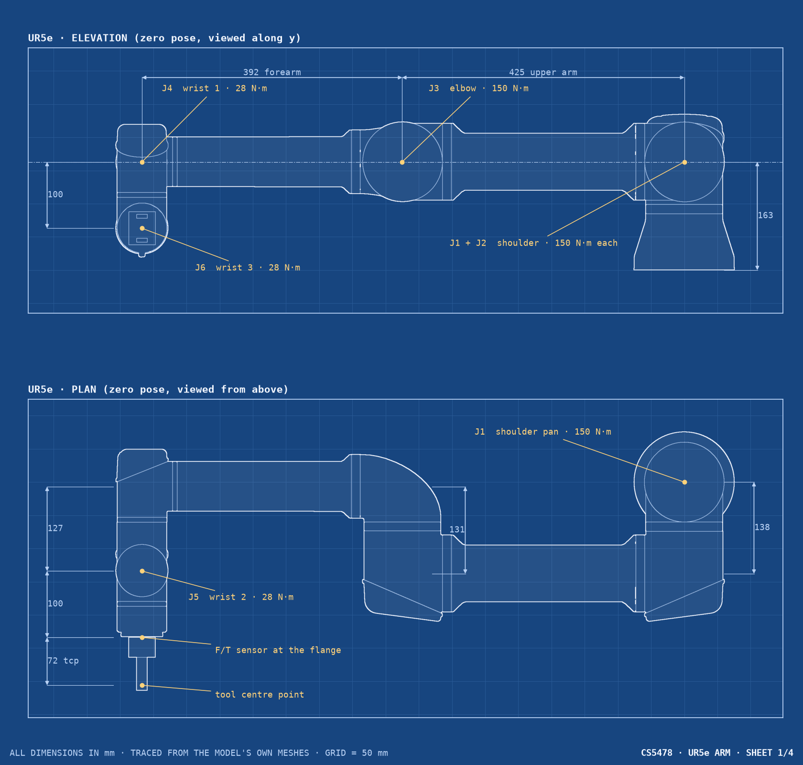
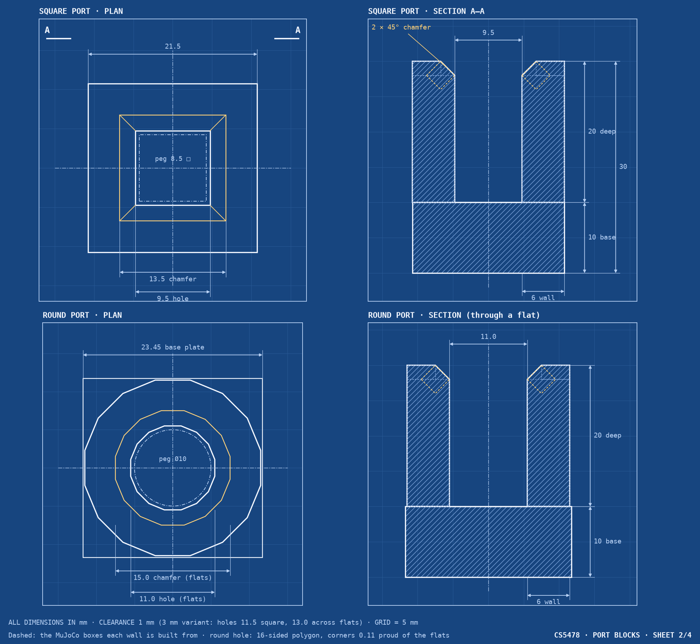
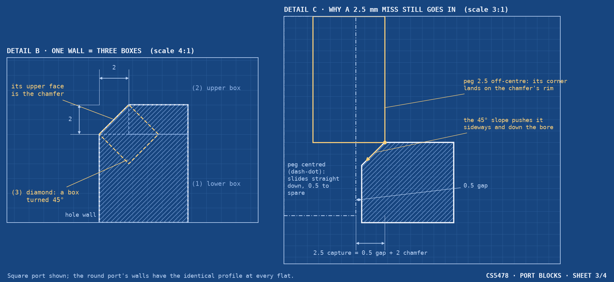
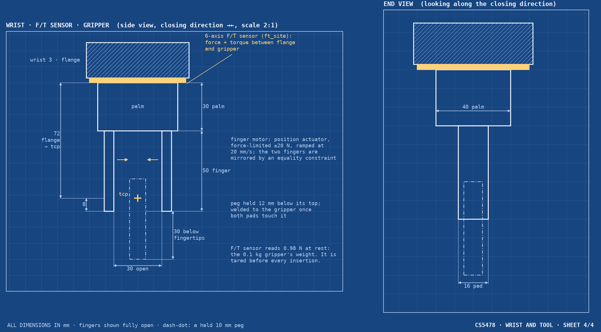
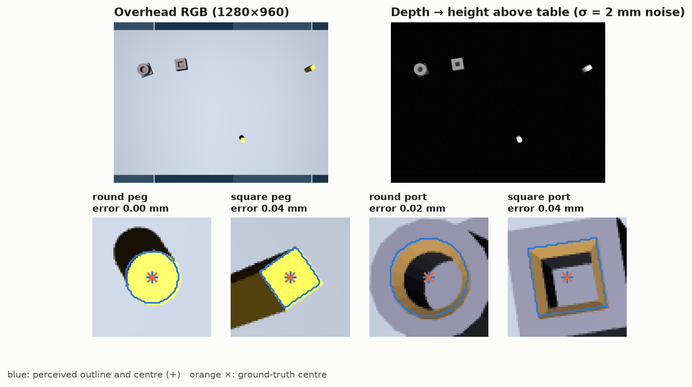
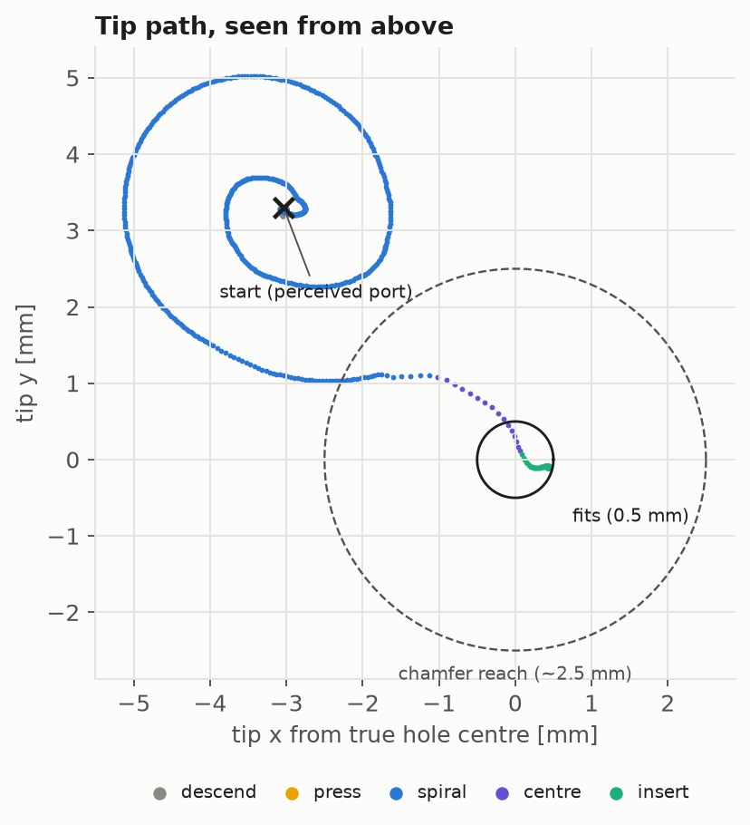
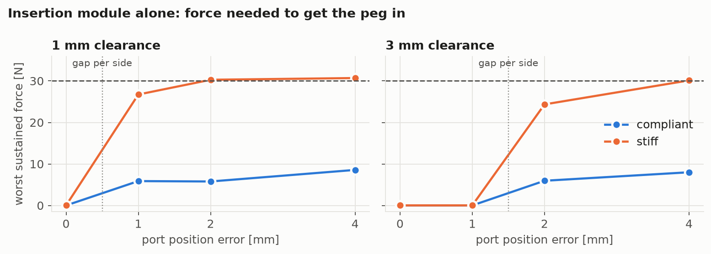
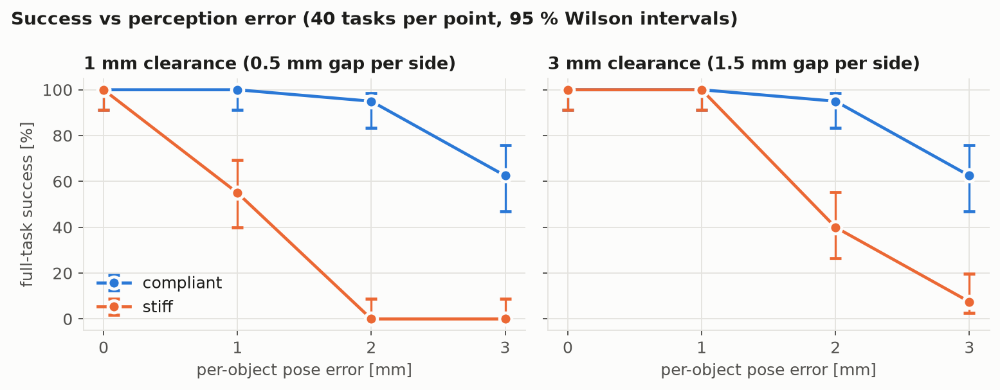
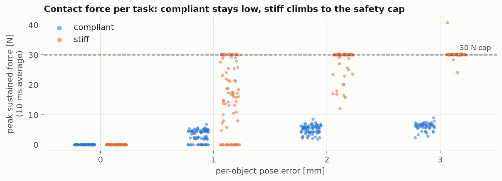
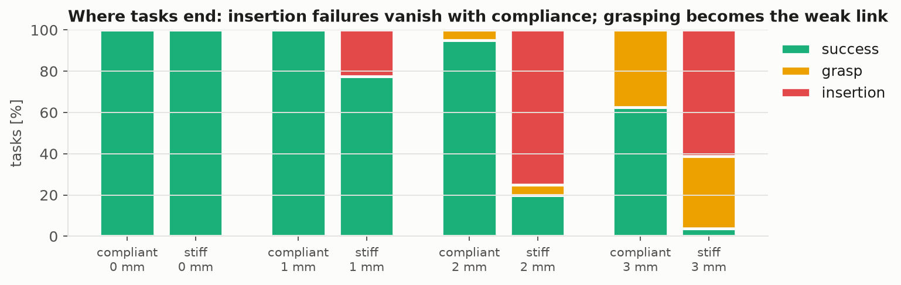

# Vision-guided, contact-rich insertion with Cartesian impedance control

**CS5478 Intelligent Robots · Project final report**

**Desmond Ang (A0093896H)**

This project simulates a vision-guided task: inserting pegs into the correct ports with a robotic arm, at millimetre-level clearance. An overhead RGB-D camera estimates the type and position of every peg and port. The arm then plans a grasp for each peg, picks it up and carries it over its port. Finally, a Cartesian impedance controller makes the arm behave like a soft spring at the tip of the peg, senses contact through a force sensor in the wrist, and searches in a widening spiral if it misses the hole. The whole pipeline is built in MuJoCo and compared, on identical random scenes, against a stiff position controller. With 2 mm of error on every object, the compliant controller completes 95 % of tasks against 20 % for the stiff arm, with no insertion failures and contact forces below 9 N, while the stiff arm repeatedly drives into the 30 N safety cap.

## 1 Problem and motivation {#problem}

Inserting one part into another is among the most common operations in manufacturing and electronics assembly: pins go into bores, connectors into sockets and shafts into bearings. Yet a conventional robot arm is poorly suited to the job. Its joints are driven by stiff position servos designed to ignore disturbances, so the arm goes exactly where it is told. If its estimate of where the hole is turns out to be wrong, it will simply try to push the part into solid metal.

That estimate comes from perception, and perception is never exact. Calibration error, occlusions and noisy depth readings all add up, and in a real robot cell they commonly produce position errors of a millimetre or more. The gap a part has to pass through can be much smaller. In the tightest case in this project, a 10 mm peg enters a hole with only 1 mm of total clearance.

There are two ways to make insertion reliable under these conditions. The first is to make perception more accurate than the clearance, which is possible but demands expensive sensors and careful, frequent re-calibration. The second is to make the robot tolerant of error: soft in the directions where it should give way, and able to sense when it has touched something. This project explores the second approach.

## 2 Approach and implementation {#approach}

The system is organised as a pipeline of five stages:

!include assets/pipeline.html

The robot controller is only ever allowed to see what the real robot could see. This means the camera image, its own joint angles from the motor encoders, the positions of its gripper fingers and the readings of the force/torque sensor. Only the evaluation harness is permitted to look at the true position of everything in the simulation, and it uses them solely to score the outcome and to measure how wrong our perception is.

### 2.1 Scene

The simulated work cell is modelled on a typical tabletop assembly station. A Universal Robots UR5e arm carries a two-fingered parallel gripper, with a six-axis force/torque sensor mounted between the gripper and the wrist. On the table in front of it stand two pegs and their two port blocks, placed at random positions and orientations generated from a numbered seed, so that every trial is a different layout yet any trial can be replayed exactly. Overhead, a fixed RGB-D camera looks straight down at the table, capturing a colour image and a depth image of the whole work area.

| Item | Specification | Why it is like this |
| --- | --- | --- |
| Round peg | Ø 10 mm × 50 mm | 10 mm is a typical small pin or connector size. 50 mm of length lets the gripper hold the top 20 mm while 30 mm still sticks out below the fingers, more than the 20 mm depth of the port. |
| Square peg | 8.5 mm × 8.5 mm × 50 mm | 8.5 mm across the flats keeps it close in size to the round peg, so both are grasped the same way, while making it incompatible with the other hole: its 12.0 mm diagonal is wider than the round hole's widest point. |
| Ports | 20 mm deep, 2 mm × 45° chamfer, total clearance 1 mm or 3 mm | The chamfer is a sloped funnel around the rim, the feature compliance relies on to guide the peg. A 45° slope turns a downward push into an equally large sideways push, and 2 mm is a typical lead-in for parts this size; together with the 0.5 mm gap it lets the hole "capture" a tip that lands up to about 2.5 mm off-centre. |
| Camera | RGB-D, 1280 × 960, 25° vertical field of view, depth noise $\sigma$ = 0 or 2 mm | At 0.75 m, a 25° view spread over 960 pixels means one pixel covers about 0.35 mm of table, so a 10 mm peg top spans roughly 30 pixels, enough to tell a circle from a square. 2 mm of depth noise is typical of consumer depth cameras at this range. |

#### UR5e Menagerie arm

The default UR5e model drives every joint with a built-in position servo, which would quietly stiffen the arm against any compliant controller built on top of it. We therefore replaced each servo with a plain torque motor, so that the torque our controller computes is exactly the torque the joint receives. Each motor is limited to the real UR5e's datasheet rating: 150 N·m on the three large joints at the base and shoulder, which carry the whole arm, and 28 N·m on the three smaller wrist joints. The trade-off is that nothing now holds the arm up against gravity except the controller itself, so every controller includes gravity compensation: at each control step, it computes the torques needed to cancel the arm's weight in its current pose.

{blueprint}

**Figure 1.** UR5e arm with link dimensions and the torque limit of each joint.

#### Ports

As MuJoCo computes collisions between meshes using their convex hull, we assemble each port from many small, simple boxes, each of which is convex on its own. The square hole is surrounded by four wall boxes, while the round hole is approximated by a ring of sixteen wall boxes arranged as a regular sixteen-sided polygon. Each wall is 6 mm thick, a little more than twice the 2 mm chamfer, so that the angled chamfer boxes fit entirely inside the wall.

The 45° chamfer at the rim is built from boxes rotated by 45° into diamond shapes, so that their upper edges form a sloped funnel around the opening. The chamfer is coloured brown, which later makes it easy for the camera to find the rim of each hole.

{blueprint}

**Figure 2.** Square and round port blocks in plan and section (1 mm clearance, mm).

{blueprint}

**Figure 3.** How each wall is built from three boxes, and how the chamfer captures a peg up to 2.5 mm off-centre.

#### Gripper and wrist sensor

The gripper has two fingers mounted on slide joints, with mirrored motion so they always close symmetrically about the centre of the gripper. A single motor drives them with a force limit of 20 N and a closing speed of 20 mm/s. Holding a small part purely through friction is notoriously difficult to simulate reliably, so we use a common simplification: at the moment both finger pads are touching a peg, the simulator welds the peg to the gripper in whatever position it happens to be.

A six-axis force/torque sensor sits between the arm's flange and the gripper, measuring the forces and twisting moments passing through the wrist.

{blueprint}

**Figure 4.** Wrist flange, force/torque sensor, gripper and tool centre point, with a held peg.

### 2.2 Perception

Perception receives a single `CameraObservation`, which bundles together the colour image, the depth image and the calibrated model of the camera. From this alone it must work out, for each peg, what kind it is, where the centre of its top face is and how it is rotated (its *yaw*), and for each port, what kind it is, where the centre of its entrance is and its yaw.

#### Step 1: the pinhole camera model

Every camera, at heart, maps points in the three-dimensional world onto a flat grid of pixels, and the simplest accurate description of that mapping is the *pinhole model*. Its central idea is similar triangles. A point at distance $d$ in front of the camera and $X$ metres to one side of its optical axis appears $fX/d$ pixels away from the centre of the image, where $f$ is the focal length measured in pixels.

The same relationship works in reverse, and this is where the depth image becomes powerful. Because every pixel carries its own depth $d$, we can run the similar-triangles calculation backwards and recover the 3D position of the surface seen through that pixel. Doing this for every pixel, a step called *back-projection*, turns the whole image into a dense cloud of 3D points in world coordinates.

#### Step 2: segmentation by height

Once every back-projected pixel has a height, separating the objects from the table is done via a *height map*, which records how far each pixel sits above the table, so that the table itself is at zero. The most common height in the scene, found with a histogram, is the table surface. Subtracting it from every pixel gives the height map.

Any pixel more than 6 mm above the table is treated as part of an object. The few isolated noisy pixels that do get through are erased by a *morphological opening*, an image operation that removes specks smaller than a small disk, here 5 pixels across, while leaving large shapes intact; real objects are tens of pixels across, so they survive untouched. Finally, *connected-component labelling* groups touching pixels into separate objects, and any group smaller than 200 pixels is discarded as leftover noise. That limit sits safely below the smallest real object, since a peg's top face alone covers about 700 pixels.

#### Step 3: finding the top face from colour

The lit top face of each peg is a bright, strongly saturated amber. Its sides, angled away from the light, are dark. The table is a pale grey with very little saturation. Selecting the bright, saturated pixels within each peg's region therefore gives a crisp outline of the top face alone, unaffected by depth noise.

#### Step 4: round or square?

To tell the two pegs apart, we compare the area of the top face with the area of the smallest rectangle that can be drawn around it, a ratio we call the *fill*. A perfect square fills its bounding rectangle completely, giving a fill of 1. A perfect circle fills only $\pi/4$ of its bounding square, about 0.785. A threshold of 0.86, between the two, separates them with plenty of margin. As a final safety net, since the scene always contains exactly one peg of each kind, if both ever looked alike the one with the higher fill would be called square.

#### Step 5: measuring a square's yaw from its whole outline

A square peg only fits its hole if it is turned to the same angle, so its yaw must be measured carefully. To do this, imagine walking all the way around a square while measuring your distance $r$ from its centre. That distance rises and falls four times, peaking at each corner, and the corners sit at the square's yaw plus 45°, plus multiples of 90°. A pattern that repeats four times per revolution is captured by the fourth Fourier harmonic of $r$ as a function of angle $\varphi$. Summing the contribution of every outline point gives a single complex number $H$ whose phase reveals where the corners are, and hence the yaw. Because every pixel contributes, the small errors from individual pixel steps cancel each other out.

#### Finding the ports from their chamfers

Ports are found in a similar spirit. The chamfer ring around each hole is brown, while the block around it is a grey-blue. The outer edge of the chamfer ring is the rim of the hole, and that rim lies exactly in the block's top plane. Perception therefore selects the chamfer pixels, fills in everything inside the ring (including the dark interior of the hole), and measures the resulting shape with exactly the same method used for a peg's top face. The centre of that shape is the entrance the peg must reach, and its fill tells a square hole from a round one just as it did for the pegs.

**Figure 5.** What perception sees and what it finds, for one layout with 2 mm depth noise. Top left is the colour image the camera captures; top right is the height map computed from depth, in which the pegs appear brightest because they are tallest. In the zoomed views, the blue outline and + mark perception's estimate and the orange × marks the true centre. Measuring only the top face, rather than the whole blob, is what stops that perspective effect from dragging the estimated centre outward.

### 2.3 Motion

Before the robot can grasp or insert anything, it needs a reliable way to move its tool to a desired position and orientation and to follow smooth paths without jerking.

#### Kinematics and the Jacobian

*Forward kinematics* is a chain of rotations and translations from the base to the gripper, and MuJoCo computes it from the arm's model. The *Jacobian* **J** is a 6 × 6 matrix that converts joint velocities into the tool's linear velocity (three numbers) and angular velocity (three more). The Jacobian is the workhorse of robot control. Both inverse kinematics and the impedance controller depend on it, and a bug in it would not crash anything, only make the arm move strangely. We therefore check it against forward kinematics, which is exact: nudging each joint by a millionth of a radian, the tool must move as the Jacobian predicts.

#### Inverse kinematics by damped least squares

We solve *inverse kinematics* iteratively. At each step we measure the remaining error $e$, which combines the position error with the rotation error expressed as an axis multiplied by an angle, and take a step $\Delta q$ in joint space that would remove that error if the arm were perfectly linear.

We include a *damping* term $\lambda^2$ in the formula below, which keeps the step small near *singular* poses, where the arm loses the ability to move in some direction (for example when it is fully stretched out). The damping value $\lambda = 0.05$ is small compared with the arm's normal sensitivity, so away from singular poses it barely changes the step, yet near them it stops the step from growing without bound. We also cap every step at 0.2 rad (about 11°) per joint. That cap has an important side effect: the solution always stays in the same arm configuration as the starting pose, so the elbow never suddenly flips from "up" to "down" in the middle of a task. A solve counts as converged when the tool is within 0.01 mm and 0.006° ($10^{-4}$ rad) of its target, both far finer than anything the task can feel. Tested on 400 random targets spread over the pick and port areas, the solver never failed, needing a median of 7 iterations and about 0.2 ms per solve.

#### Smooth trajectories

Commanding the arm to jump straight to a new target would make it lurch, overshoot and strain its motors. Every motion therefore follows a *quintic* time profile, $s(\tau) = 10\tau^3 - 15\tau^4 + 6\tau^5$, which carries the progress variable $s$ smoothly from 0 to 1 as normalised time $\tau$ runs from 0 to 1. This particular polynomial is the "minimum-jerk" curve: it starts and ends with zero velocity and zero acceleration, so the arm glides into motion and settles gently at the end. Each move's duration is chosen to respect a speed limit: 1 rad/s for the fastest joint during transfers, a brisk but unhurried pace for an arm of this size, and 5 cm/s for straight-line moves near objects, slow enough that the tool arrives gently.

There are two kinds of move. Large transfers across the workspace, such as from the ready pose to above a peg, interpolate the joint angles directly. This is fast and safe, but it makes the tool travel along a gentle curve. Moves close to objects, such as descending onto a peg or lowering it towards a port, must follow a straight line, so the line is sampled every 2 ms, far more finely than the motion changes (the tool moves at most 0.1 mm in that time), and each sample is solved with inverse kinematics, starting each solve from the previous one so that it converges in one or two iterations.

#### Following a trajectory: computed-torque control

For motion through free space the arm uses a controller called *computed-torque control*. It compares where each joint is with where the trajectory says it should be, and computes a corrective acceleration as if each joint were attached to its target by a spring and a damper. We use a natural frequency of 20 rad/s with critical damping ($\zeta = 1$): critical damping means the joint settles without overshooting.

$$
\tau = M(q) \left( \ddot q_\text{ref} + K_p (q_\text{ref} - q) + K_d (\dot q_\text{ref} - \dot q) \right) + \text{bias}(q, \dot q), \qquad \omega_n = 20\ \text{rad/s}, \quad \zeta = 1
$$

### 2.4 Grasping and carrying

#### Choosing a grasp from the outline

A peg standing upright is a *prism*: its side faces are simply its top-face outline extended straight downwards. This means the outline that perception already measured tells us the direction of every side face of the peg, which is exactly the information a grasp planner needs. The gripper's two pads are flat plates. When they close along some direction *d*, each pad touches the points of the outline that stick out furthest along that direction. The planner tries 72 closing directions, spaced 2.5° apart. For each direction it checks three conditions. A grasp is kept only if, on both sides of the peg:

- **The contact is on a flat or a gentle curve, not a corner.** A flat pad pressing on a corner tends to slip off or twist the part. We measure how wide the patch of contact is, counting every outline point within 0.5 mm of the outermost one (about one and a half pixels, enough to absorb the pixel staircase along a straight edge), and a patch narrower than 2 mm counts as a corner. This threshold was not guessed: we measured the patches on real perceived outlines and found that round pegs always give patches of at least 2.3 mm, whereas a square's corners never give more than 2.0 mm.
- **The surface normal lies inside the friction cone.** When a pad squeezes a surface that is tilted relative to the closing direction, part of the squeezing force tries to push the part sideways out of the grip. Friction can resist this only if the tilt is smaller than $\arctan\mu$, where $\mu$ is the coefficient of friction. Contacts that satisfy this on both sides form an *antipodal grasp*, the classic condition for a stable, force-closed two-finger grip.
- **The open fingers clear every other object** as the gripper descends, keeping at least 3 mm of space.

Among all the grasps that pass, the planner prefers the one whose contact normals line up best with the closing direction, and among equally good grasps it prefers the one that requires the least rotation of the wrist. Grasps whose alignment is within 5° of the best are treated as equally good, because the pixel staircase alone makes a circle's measured normals wobble by 1 to 2°. For the square peg, a final refinement re-measures the contacts along the axis defined by the two contact normals, repeating a few times until the closing direction settles exactly onto the normal of the square's faces. On perceived pegs this lands within 1.2° of the true face normal, with a median error of 0.35°. For the round peg every direction is equally good, so the wrist simply does not turn.

![Four panels of grasp planning on perceived peg outlines. (a) The square peg with two grey pads lying flat on opposite faces, the contact points in green, and arrows showing the squeeze inside shaded friction cones. (b) The square peg with the pads turned 45 degrees so they touch only corners, contacts 0.9 and 1.2 millimetres wide, in orange. (c) A ring of 72 spokes around the square peg: green where the direction passes, orange where it would grip a corner, with the chosen direction in blue. (d) The same ring for the round peg, where every spoke is green.](assets/fig_grasp.png){width=720}

**Figure 6.** Grasp planning on perceived outlines (2 mm depth noise). (a) A grasp that passes: both pads lie flat on a face, and the squeeze (arrows) stays inside the friction cone (shaded). (b) Turned 45°, the pads touch only corners, with contacts narrower than 2 mm, so this direction is rejected. (c) All 72 directions for the square peg: only those near a face pass, and the chosen one needs the least wrist turn. (d) For the round peg every direction passes.

#### Picking, checking, and estimating where the peg sits in the hand

The arm moves to a point 50 mm above the planned grasp, high enough that the fingertips clear the top of the 50 mm peg with room to spare, descends in a straight line until the tool's centre is 12 mm below the peg's top, and closes the fingers. The 12 mm depth is chosen so that the pads cover the top 20 mm of the peg while 30 mm sticks out below the fingertips. When the peg is later pushed 20 mm into its port, the fingertips therefore still stay about 10 mm above the block. It then checks that the fingers stopped within 1.5 mm of the width the planner expected. Importantly, this check uses only the finger positions, the same signal a real gripper would report, and never the simulator's internal record of whether a grasp happened.

Next the robot estimates where the peg sits inside its hand, because this determines where the peg's tip will be during insertion. Two sources of information are combined. Along the closing direction, the mirrored fingers have pushed the peg to the exact centre of the gripper, so that offset is known to be zero. Along the width of the pads, there is no such mechanical centring, so the robot relies on perception, measured relative to where its encoders say the tool actually was at the moment of grasping. The result is the position of the peg's tip expressed in the tool's own frame.

The arm then lifts the peg 100 mm, twice the height of the other peg, so it can be carried over everything on the table, then carries it over its port, turns it to match the port's yaw if it is the square peg, and lowers it until the tip hovers 10 mm above the perceived entrance. Ten millimetres is far more than perception's height error (under 0.4 mm), so the peg cannot touch the block early, yet close enough that the final descent takes only about a second.

### 2.5 Compliant insertion

This is the heart of the project. The compliant insertion skill combines the three ideas set out in the proposal: a Cartesian impedance controller that lets the arm yield to contact, force-triggered contact detection using the wrist sensor, and a spiral search to find a hole that the robot has missed.

#### Impedance control: turning the arm into a spring

An impedance controller commands a *relationship* between position error and force. The controlled point (peg's tip) behaves as if it were attached to a moving target point, called the setpoint, by a spring of stiffness K and a damper D. If nothing touches the peg, the spring pulls it to the setpoint. If something pushes on the peg, it gives way by an amount equal to the push divided by the stiffness, exactly like a spring.

The controller is soft sideways and firmer downwards: 300 N/m in both horizontal directions, 1000 N/m vertically, and a stiff 10 N·m/rad in rotation so that the peg stays upright. At 300 N/m, a peg that is 2.5 mm out of line generates less than 1 N of sideways resistance, so the chamfer can easily nudge it into position. The vertical 1000 N/m is firmer because pressing down is the one thing the arm must do deliberately. Once the tip is on the chamfer, the controller goes one step further: at every control step it places the setpoint's horizontal position on the tip itself, so the sideways spring is never stretched and pulls with no force at all, while keeping the setpoint 4 mm below the tip, which at 1000 N/m gives a gentle 4 N press. The chamfer's slope is then the only thing pushing the peg sideways, and it always pushes towards the hole.

We verified the behaviour directly by pushing on the tip with a known external force and measuring how far it moved. A 3 N sideways push moved it 9.8 mm, against a theoretical $3/300$ m = 10 mm, and a 5 N push upwards moved it 5.0 mm, exactly the $5/1000$ m predicted.

![Two panels explaining impedance control. (a) A held peg whose tip is tied to a setpoint by a soft sideways spring of 300 newtons per metre and a firmer vertical spring of 1000 newtons per metre, each with a damper, labelled F equals K times x d minus x, minus D x dot. (b) A cross-section of a peg landing 1.8 millimetres off-centre on the 45-degree chamfer: the 4 newton press makes the chamfer push back up and towards the centre, giving about 4 newtons sideways, while the soft spring resists with only about 0.5 newtons.](assets/fig_impedance.png){width=820}

**Figure 7.** Impedance control. (a) The peg's tip is tied to a setpoint by a virtual spring and damper, soft sideways and firmer vertically. (b) When the tip lands on the chamfer, the 45° slope turns the 4 N press into a sideways push of about 4 N, while the soft spring resists with only about 0.5 N, so the peg slides into the hole.

#### Feeling contact with the wrist sensor

The force sensor in the wrist cannot tell the difference between the weight of the gripper and peg hanging from it and a genuine contact force. Before every insertion, the robot therefore holds still for a moment in free space and *tares* the sensor, zeroing out the weight so that any later reading is due to contact alone. Testing uncovered two practical details that are easy to get wrong.

1. The first is a matter of sign and frame: MuJoCo's sensor reports the force that the gripper exerts on the flange, expressed in the sensor's own rotating frame, so the force that the environment exerts on the tool is the negative of that, rotated into world coordinates.
2. The second is a matter of timing: the sensor reads zero until the physics has taken its first step, so taring immediately after a reset was off by the weight of the gripper. The robot holds still for 0.2 s before taring, about the time the arm takes to settle after its last move.

#### The insertion as a sequence of phases

The insertion is organised as a *state machine*, shown in Figure 8, which moves through a series of phases depending on what the robot senses. There is a single idea that makes the whole design simple: **every phase only moves the spring's setpoint, and the spring does the rest**. To press down with a force F, the setpoint is placed F/K below the tip. To let the hole guide the peg sideways, the setpoint is placed directly on the tip, so that no spring pulls the peg in any horizontal direction. In this way one controller can descend, press, search and comply, just by choosing where to put its setpoint.

!include assets/state_machine.svg

**Figure 8.** The compliant insertion state machine. "Drops 3 mm" means the tip has gone 3 mm below where it first touched, which takes it past the 2 mm chamfer and into the hole itself. The search gives up beyond a 6 mm radius, and any phase is abandoned if the sustained force exceeds 30 N or if 60 s pass.

Reading the diagram from left to right, the phases work like this:

| Phase | What the robot does |
| --- | --- |
| **Descend** | The setpoint sinks at 10 mm/s and the soft spring draws the peg down after it. |
| **Press** | Holds a gentle 4 N downward push with no sideways pull for 0.3 s. On the chamfer, the slope turns that push into a sideways nudge and the peg slides into the hole by itself; on the flat top of the block, friction holds it still. |
| **Spiral** | The hole must be somewhere nearby, so the arm searches in a widening spiral while still pressing gently, as described below. |
| **Centre** | The arm stops spiralling and goes limp sideways so the chamfer can guide the peg in. |
| **Insert** | The tip is 3 mm below where it first touched, so it is inside the hole. The setpoint descends towards the floor, but never more than 15 N's worth below the tip, so the push is capped at half the 30 N limit however tightly the peg sticks. |
| **Release** | The gripper opens and the arm lifts away, leaving the peg seated. |

Each of these phases depends on a handful of numbers. They were chosen by reasoning about the physics first and then confirmed in trials, and the table below records the reason for every one.

| Setting | Value | Why this value |
| --- | ---: | --- |
| Descent speed | 10 mm/s | Covers the 10 mm hover in about a second, yet slow enough that the first touch is gentle and the contact threshold is crossed before much force builds up. |
| Contact threshold | 2 N | A light touch, but many times larger than the filtered sensor's resting noise, so it never triggers by accident. |
| Pressing force | 4 N | On a 45° chamfer a 4 N press produces a sideways push of similar size, which easily beats the 300 N/m spring for the 2.5 mm the chamfer can correct. It is also small enough that friction while searching (0.8 × 4 = 3.2 N at the highest friction) stays below the 8 N sideways cap. |
| Press and centring waits | 0.3 s | About the time the soft spring needs to let the chamfer slide the peg across; waiting longer only wastes time on the flat top of the block. |
| "Caught by the chamfer" | 0.8 mm dip | Far deeper than the tip ever dips while sliding over the flat block top, yet less than half of the chamfer's 2 mm depth, so the controller reacts early, while the tip is still on the slope. |
| "In the hole" | 3 mm drop | The 2 mm chamfer plus 1 mm of margin: a tip this far below its first contact must be inside the bore itself. |
| Sideways stiffness while searching | 1500 N/m | Friction drags the tip behind its setpoint by $\mu F/K$. At the soft 300 N/m and the highest friction that lag would be $3.2/300$ m ≈ 11 mm, larger than the whole spiral; at 1500 N/m it is about 2 mm. |
| Sideways pull cap | 8 N | More than twice the largest friction (3.2 N), so the spiral can always drag the tip along, yet far below 30 N, so a stuck tip never stretches the spring into a violent release. |
| Spiral pitch | 1 mm per turn | Smaller than the chamfer's 2.5 mm capture radius, so consecutive turns overlap and no hole can hide between them. |
| Spiral speed | 5 mm/s | Slow enough for the chamfer to catch the tip as it passes over the rim; fast enough that the search reaches its 6 mm limit in about 23 s, leaving more than half of the 60 s budget. |
| Search radius limit | 6 mm | Twice the largest per-object error we inject (3 mm). That is the worst case, when a peg's error and its port's error point in opposite directions and add up. |
| Insertion push | 15 N | Half of the 30 N cap: firm enough to overcome friction in the bore, with a 2× safety margin below the limit. |
| Seated tolerance | 1.5 mm | Larger than perception's height error (under 0.4 mm), so a fully seated peg is always recognised, but far smaller than the 20 mm depth, so a peg stuck partway never counts. |
| Stall time | 1 s | At 10 mm/s a moving peg would travel 10 mm in a second, so a second with no progress means it is genuinely jammed. |

#### The spiral search

The search follows an *Archimedean spiral*, $r = \text{pitch} \cdot \theta / 2\pi$, whose radius grows steadily by one pitch with every full turn. The pitch is set to 1 mm, which is smaller than the chamfer's capture radius of about 2.5 mm. That guarantees the spiral sweeps the whole area around the starting point without leaving gaps large enough for a hole to hide in. To keep the tip moving at a steady 5 mm/s along the spiral, the angle cannot simply increase at a constant rate; it must grow as $\theta = \sqrt{2vt/b}$, where $b = \text{pitch}/2\pi$. The search gives up if the radius exceeds 6 mm, which at 5 mm/s happens after about 23 s.

{width=520}

**Figure 9.** A single compliant insertion, recorded in detail, with the perceived port deliberately placed 4.5 mm away from the real one. The path of the peg's tip is seen from above, coloured by phase; the small solid circle is where the peg fits and the dashed circle is the reach of the chamfer.

### 2.6 The baseline: stiff position control

To show what compliance actually buys, the comparison has to be fair. The baseline therefore runs exactly the same pipeline as the compliant controller: the same perception, the same grasp, the same carry to the port, the same descent speed and the same 30 N safety cap. Only the final insertion differs. The baseline inserts the way a conventional industrial arm would, using the same impedance controller but with its stiffness raised to 20 000 N/m in every direction (and 200 N·m/rad in rotation), about seventy times stiffer sideways than the compliant setting. It drives the tip straight down to the perceived floor of the port, with no contact detection and no search.

### 2.7 The evaluation harness and its statistics

A single full-task trial runs the entire system from start to finish. The camera takes one photograph, perception interprets it, and then for each peg in turn the robot picks, carries, inserts and releases it. At the very end, success is judged against ground truth, including a recheck that inserting the second peg did not knock the first one out of place.

To test robustness, the harness can deliberately make perception wrong. In the *pose-error* condition, every perceived object is shifted by a fixed distance in its own random direction. We use 0, 1, 2 and 3 mm, a range chosen to straddle the interesting thresholds: 1 mm is beyond the 0.5 mm gap at the tight clearance, 2 mm is close to the chamfer's 2.5 mm reach, and 3 mm forces the search to do real work. This models calibration errors that differ from object to object, as they often do in practice. Because the error on each peg and the error on its port are independent, the relative error between them ranges anywhere from zero, when the two shifts happen to cancel, up to twice the injected amount, when they add.

Both controllers always run on exactly the same seeds, so their results come in matched pairs. Two statistical tools from the proposal turn the raw counts into trustworthy conclusions:

- **Wilson 95 % confidence intervals** on success rates. The 95 % level ($z = 1.96$) is the conventional choice, and the one the proposal specifies.
- **The exact McNemar test** for paired comparisons. When two controllers attempt the same seeds, the seeds that both solve, or both fail, tell us nothing about which controller is better. Only the *discordant* seeds, solved by one controller but not the other, carry information. If the two controllers were truly equally good, each discordant seed would be like a fair coin toss, equally likely to favour either one. The p-value is the probability of seeing a split at least as lopsided as the one observed under that fair-coin assumption, which is a simple binomial calculation.

Cycle times are compared only on seeds that both controllers solved, because otherwise a controller that gives up quickly on difficult cases would appear misleadingly fast.

## 3 Results {#results}

### 3.1 How accurate is perception?

Across 50 random layouts, perception found and correctly identified every peg and every port, both without depth noise and with 2 mm of noise. The table below compares its estimates with the true positions.

| Depth noise $\sigma$ | Object | xy median | xy 95th pct | xy max | height 95th pct | square yaw max |
| --- | --- | ---: | ---: | ---: | ---: | ---: |
| 0 | pegs | 0.032 mm | 0.058 mm | 0.091 mm | 0.002 mm | 1.02° |
| 0 | ports | 0.019 mm | 0.059 mm | 0.070 mm | 0.002 mm | 0.42° |
| 2 mm | pegs | 0.035 mm | 0.094 mm | 0.113 mm | 0.26 mm | 1.02° |
| 2 mm | ports | 0.029 mm | 0.061 mm | 0.073 mm | 0.20 mm | 0.42° |

The simulated camera is perfectly calibrated, perfectly lit and free from lens distortion, and its colours contain no noise at all. Because positions are measured from colour outlines and depth is used only to set the height of a plane, even substantial depth noise hardly affects the result. As a real camera would not be this kind, the proposal includes a robustness condition with deliberately injected error.

### 3.2 The insertion module on its own

Before running complete tasks, we tested insertion in isolation, in 128 trials (2 controllers × 2 clearances × 2 friction values × 4 port errors × 2 pegs × 2 seeds). In each trial the robot perceived the scene, picked a peg and carried it to its port, and then we shifted the perceived port sideways by a known amount, so that the robot would arrive deliberately off-target. Both controllers faced the same shifts, at two clearances and two friction levels. The four port errors, 0, 1, 2 and 4 mm, were chosen to probe each regime in turn: no error, an error just beyond the tight gap, an error inside the chamfer's 2.5 mm reach, and one beyond it that requires a search. Figure 10 shows the worst sustained force each controller needed to get the peg in.

**Figure 10.** Insertion on its own: the worst sustained force over the 8 trials at each point (2 friction values × 2 pegs × 2 seeds). The dotted vertical line marks the gap per side, the amount of error the peg can absorb without touching anything.

For the stiff arm, the limit is set by the clearance: giving it a looser hole gives it roughly one more millimetre of tolerance, after which it jams just the same. For the compliant arm, the limit is set by the reach of the chamfer and the search, and the clearance hardly matters at all. Higher friction mostly costs the compliant arm time rather than success, because the chamfer struggles to slide a peg against more friction, so even small errors sometimes require a short search.

### 3.3 The full-task grid with clean perception

The proposal's main experiment crosses every combination of clearance {3, 1} mm, friction {0.3, 0.8} and camera noise {off, 2 mm}. The friction values bracket the range of real materials, from slippery (0.3, like smooth plastic on metal) to grippy (0.8, like rubber or rough surfaces), with 20 random seeds per combination and both controllers attempting the same seeds. That makes a total of 320 complete tasks.

Both controllers succeeded in all 20 tasks of every condition (Wilson interval 84 % to 100 %), so the McNemar test gave p = 1 everywhere. With perception accurate to about 0.1 mm, no task failed at any stage. The only measurable difference was that the stiff arm finished each task about 0.2 s sooner, since it skips the contact checks.

### 3.4 Robustness: what happens when perception is wrong

The robustness experiment repeats the grid with camera noise switched on and an independent pose error of 0, 1, 2 or 3 mm added to every perceived object, giving 640 complete tasks. This is where the two controllers finally part ways, and the separation is stark.

**Figure 11.** Full-task success as the perception error grows, pooled over the two friction values so that each point represents 40 tasks (2 friction values × 20 seeds), with 95 % Wilson intervals shown as error bars. With 1 mm clearance, the stiff arm already loses almost half its tasks at 1 mm of error and every single task at 2 mm. With 3 mm clearance it survives 1 mm of error, thanks to the larger gap, but collapses at 2 mm. The compliant arm holds 95 % success up to 2 mm of error at either clearance.

The table below breaks the result down condition by condition, including the paired McNemar comparison. The columns "only compliant solved" and "only stiff solved" count the discordant seeds, the only ones that carry evidence about which controller is better.

| Clearance | Friction | Pose error | Compliant success | Stiff success | Only compliant solved | Only stiff solved | McNemar p |
| --- | --- | --- | ---: | ---: | ---: | ---: | ---: |
| 1 mm | 0.3 | 1 mm | 20/20 | 13/20 | 7 | 0 | 0.016 |
| 1 mm | 0.3 | 2 mm | 19/20 | 0/20 | 19 | 0 | < 0.0001 |
| 1 mm | 0.3 | 3 mm | 13/20 | 0/20 | 13 | 0 | 0.0002 |
| 1 mm | 0.8 | 1 mm | 20/20 | 9/20 | 11 | 0 | 0.001 |
| 1 mm | 0.8 | 2 mm | 19/20 | 0/20 | 19 | 0 | < 0.0001 |
| 1 mm | 0.8 | 3 mm | 12/20 | 0/20 | 12 | 0 | 0.0005 |
| 3 mm | 0.3 | 1 mm | 20/20 | 20/20 | 0 | 0 | 1.0 |
| 3 mm | 0.3 | 2 mm | 19/20 | 9/20 | 10 | 0 | 0.002 |
| 3 mm | 0.3 | 3 mm | 13/20 | 2/20 | 11 | 0 | 0.001 |
| 3 mm | 0.8 | 1 mm | 20/20 | 20/20 | 0 | 0 | 1.0 |
| 3 mm | 0.8 | 2 mm | 19/20 | 7/20 | 12 | 0 | 0.0005 |
| 3 mm | 0.8 | 3 mm | 12/20 | 1/20 | 11 | 0 | 0.001 |

First, across every condition with pose error, not a single seed was solved by the stiff arm alone. Every discordant pair favours compliance. Second, in every condition where the two controllers differ at all, the difference is statistically significant at the 5 % level, and most of the p-values are far smaller than that. The only conditions with p = 1 are those where the 3 mm clearance gave the stiff arm enough room to cope with 1 mm of error.

**Figure 12.** The peak sustained force (10 ms average) in every task, one dot per task. Compliant insertions never exceeded 9 N, however large the error. Stiff insertions climb towards the 30 N cap as soon as the error exceeds the gap, and at 2 and 3 mm almost all of them sit right on the cap, because that is how they fail: the safety limit stops the arm before anything breaks. One stiff trial registered 40.7 N because a single sharp impact arrived faster than the abort could act; single-step peaks like this are reported separately in the data.

**Figure 13.** How each task ended, for each controller and level of pose error, with 80 tasks per bar (2 clearances × 2 friction values × 20 seeds). Green tasks succeeded, yellow tasks failed while grasping, and red tasks failed while inserting. Across all 320 robustness tasks each, the compliant controller had **0** insertion failures and 34 grasp failures, while the stiff controller had 127 insertion failures and 32 grasp failures.

### 3.5 The new weak link: grasping a peg that is not where we think

Figure 13 revealed something we had not anticipated. Every single failure of the compliant controller happened during grasping, not insertion. Both controllers lost roughly the same number of grasps, which is reassuring, since grasping is shared code and should not depend on which insertion strategy follows. Almost all of these failures involved the round peg. To understand why, we replayed a sample of the failed grasps and watched closely. In each case, perception had placed the peg about 2 mm or more away from the centre along the direction in which the fingers close.

Because the peg was off-centre, one finger reached it before the other and began to push it. That finger pressed on the peg around 38 mm above the table, the height of the tool's centre, since we grasp 12 mm below the 50 mm top. That gives the push a long lever arm, so instead of being pushed neatly to the centre, the peg tipped over slightly, and a leaning peg appears wider between the fingers than an upright one.

The width check noticed that the fingers had stopped at the wrong width and rejected the grasp, which was the right decision, because a tilted peg would only have jammed in its port. With insertion now so robust, the grasp has become the system's limiting factor.

## 4 Conclusions {#discussion}

### Limitations

A simulation study is only as convincing as its honesty about what it leaves out. The following simplifications should be kept in mind when interpreting the results:

- **Perception is idealised.** The camera has perfect calibration, no lens distortion and perfect lighting, and noise appears only in the depth image. The chamfers are coloured to make the holes easy to find. The injected pose error stands in for all of these real-world imperfections, but its particular form, a fixed distance in a uniformly random direction for each object, is itself a simplification.
- **Grasping uses a weld.** Once both pads touch a peg, the simulator locks it rigidly to the gripper. A real grasp held only by friction could slip or rotate under the forces of insertion, and our in-hand estimate never had to cope with that.
- **Contact is simulated in 1 ms steps.** The occasional single-step force spikes, sometimes hundreds of newtons for one millisecond, are partly an artefact of the time step. We followed the proposal in capping the 10 ms average rather than the instantaneous value, but a real force-limited robot cell would behave somewhat differently at those moments.
- **Twenty seeds per condition** is enough for firm conclusions where the controllers differ widely, as they mostly do. It leaves wide confidence intervals around success rates near 60 %, as in the 3 mm error conditions.

### Key takeaways

1. **Compliance turns an accuracy problem into a geometry problem.** A stiff arm needs perception that is better than the clearance, which here means half a millimetre. A compliant arm only needs perception good enough to land the tip somewhere on the chamfer, about 2.5 mm, and a search extends that reach further still.
2. **Let the geometry do the work.** The single biggest improvement to the search came from switching the sideways spring *off* at the moment the chamfer engaged. Controllers that fight against contact lose to controllers that make use of it.
3. **A system is only as robust as its least tolerant stage.** Once insertion stopped failing, grasping immediately became the limiting factor. Robustness has to be designed from one end of the pipeline to the other, not one stage at a time.
4. **An easy experiment can hide the very difference you are looking for.** The clean grid reported 100 % success for both controllers. Only the robustness condition, which the proposal included for exactly this reason, revealed how different they really are.

## A Reproducing the results {#appendix}

Every number in this report comes from a seeded run and can be regenerated exactly. With the project's virtual environment active, run the following commands from the root of the repository:

| Command | Produces | Time |
| --- | --- | ---: |
| `pytest` | All 100 tests | ~45 s |
| `python scripts/scene_check.py` | Rest and keying checks (section 2.1) | ~5 s |
| `python scripts/perception_check.py` | Perception error, 50 layouts (3.1) | ~20 s |
| `python scripts/insertion_check.py` | Insertion-module grid, 128 trials (3.2) | ~2.5 min |
| `python scripts/task_grid.py --seeds 20` | Full-task grid, 320 tasks (3.3) | ~3 min |
| `python scripts/task_grid.py --seeds 20 --noise 2 --pose-error 0 1 2 3 --out results/robustness` | Robustness grid, 640 tasks (3.4) | ~6 min |

Random streams
: Layout `[seed, 3]` pegs and `[seed, 6]` ports, camera noise `[seed, 9]`, insertion-grid port error `[seed, 12]`, pose error `[seed, 15]`. Changing one never changes another, and both controllers see identical conditions.

Code size
: sim 831 · perception 357 · motion 420 · grasp 232 · insertion 271 · harness 553 lines; tests 1 144; scripts 245.
